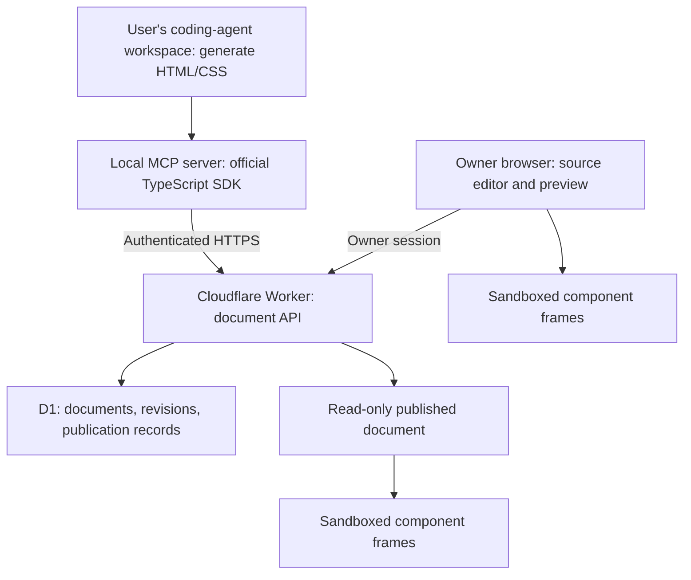

> **Implementation update (2026-10-13):** React + Vite + TipTap replaces the original browser UI. Email/password accounts, Google OAuth integration (requires deployment credentials), tenant isolation, one-document installation trials, explicit browser claiming, account MCP tokens, and a publishable bundled MCP package are implemented. Real browser + packaged MCP acceptance covers signup through account connection. Live collaboration/comments and public deployment remain future work. See README.md for current setup and behavior; the proposal below records the original MVP scope.

# DocSync MVP plan

**Status:** Approved for implementation by the user. The local MVP code is implemented and focused checks pass. HTTP/browser verification is blocked by sandbox permissions; hosted deployment requires account access.

## Goal

Build a document editor where documents contain rendered HTML components instead of a rich-text document model. A connected coding agent generates components from information in the user's workspace and updates documents through MCP. For a report-plus-link request, the agent verifies and publishes a saved revision and returns its read-only link. The owner can also review and edit in the browser.

## Recommended decisions

| Decision | MVP recommendation | Reason |
| --- | --- | --- |
| Generation location | User's coding-agent workspace | Uses existing agent context and access; avoids a second AI backend and API bill. |
| Component format | HTML + CSS sections | Supports layouts, cards, tables, and self-contained visuals without running arbitrary scripts. |
| Editing | Section source editor with rendered preview | Keeps the MVP small while supporting arbitrary HTML layouts. |
| Ownership | One owner per deployment | Avoids team account and permission infrastructure. |
| Sharing | Connected agent publishes the requested saved revision and returns a link | Private edits never silently change shared content; browser publication remains available. |
| Agent connection | Local MCP server using stdio, calling the hosted API over HTTPS | Fits a workspace-based MCP agent workflow; credentials stay outside document content. |
| Deployment | Cloudflare Worker assets + API, with D1 | One deployment and managed SQLite; targets free hosting quotas. |

The user approved the initial MVP and subsequently requested an installable plugin that creates a report and returns its link. Agent publishing and a standalone cross-agent MCP executable extend the initial recommendation.

## Architecture

The agent owns generation. The backend owns authorization, validation, persistence, revision conflicts, and publication. The browser owns rendering. The server does not compile or execute agent-generated code.

### Stack

- **Frontend:** TypeScript, esbuild, native browser controls and sandboxed iframes. No rich-text framework required.
- **Backend:** TypeScript Cloudflare Worker, serving static assets and the HTTP API.
- **Database:** Cloudflare D1 with versioned SQL migrations.
- **MCP bridge:** Node.js and the official MCP TypeScript SDK, using stdio.
- **Local development:** esbuild and a loopback Node.js server with a SQLite adapter matching the D1 query interface. Wrangler is used for hosted deployment. This keeps local development runnable with the tools available offline.
- **Verification:** Focused API/storage tests, MCP integration tests, and browser checks for editing, sharing, and isolation.

Use the same document operations for browser and MCP writes so validation and concurrency rules have one owner.

## Document model

A document contains a title and ordered sections. Each section has a stable ID, HTML, and CSS. A revision captures the complete title and section list.

| Record | Responsibilities |
| --- | --- |
| Document | Stable ID, current revision, creation/update timestamps |
| Revision | Document ID, revision number, immutable content snapshot, timestamp |
| Publication | Document ID, published revision, share-token hash, revocation state |
| Agent credential | Token hash, allowed operations, revocation state |

Saving requires the expected current revision. The backend atomically checks it and creates the next revision. Stale writes fail with a conflict and the current revision; they never silently overwrite changes. Restoring an old revision creates a new revision rather than deleting history.

## MCP contract

| Tool | Behavior |
| --- | --- |
| `list_documents` | Return accessible document IDs, titles, and revision numbers. |
| `get_document` | Read the current content and revision for editing. |
| `create_document` | Validate and save a title and ordered sections as the first revision. |
| `update_document` | Save a complete updated snapshot with an expected revision. Preserve unchanged section IDs. |
| `get_connection` | Check connectivity, publishing permission, and local-only link status before generating a shared report. |
| `publish_document` | Publish a verified saved revision and return its read-only URL, using a publishing-enabled agent token. |

The bridge forwards structured content to the API. It does not execute submitted HTML, run shell commands, or independently read workspace files. The connected agent supplies the relevant content using its existing workspace access.

The user subsequently requested an install-once, report-plus-link workflow. A publishing-enabled agent token can publish a requested saved revision and return its URL. Existing tokens remain draft-only until the owner rotates them with an explicit publishing grant. Credential administration and revocation remain owner actions.

## User flow

1. The owner opens the editor and creates a private document, or asks the connected agent to create one through MCP.
2. The agent gathers relevant workspace information and generates HTML/CSS sections.
3. The agent reads the current document revision and sends an update through MCP.
4. The owner reviews the rendered document, edits section source, and adds, removes, or reorders sections.
5. Saving persists a new revision. Checking for remote updates preserves unsaved local edits and exposes conflicts.
6. The owner publishes the reviewed revision and copies its read-only URL.
7. Readers open the link without an owner account. Later draft edits remain private until the owner republishes.
8. The owner can revoke the link or restore a previous revision. Revocation prevents subsequent server reads; it cannot retract copies already downloaded by readers.

## Editor scope

- Document list and document creation.
- Title and section HTML/CSS editing with preview.
- Section creation, removal, and reordering.
- Explicit saving, unsaved-change protection, and revision conflict handling.
- Refresh/check for agent updates without discarding local edits.
- Revision history and restore.
- Publish, republish, copy share link, and revoke.
- Responsive layout and keyboard-accessible controls.

This is source editing with preview, not Google Docs-style inline WYSIWYG editing.

## Security and correctness

### Rendering boundary

- Treat all component content as untrusted, including agent output.
- Render components inside sandboxed iframes with a restrictive Content Security Policy.
- Disable scripts, forms, popups, top navigation, external requests, and access to editor cookies or storage.
- Sanitize HTML and validate CSS using maintained tooling; do not rely on regular expressions for sanitization.
- Apply request, document, and section size limits. Return actionable validation errors.
- Keep application controls and credentials outside the rendering frames.

### Access boundary

- Keep drafts and revision history behind owner or scoped agent authentication.
- Use a securely bootstrapped owner credential and an expiring HttpOnly, Secure browser session in production; protect state-changing browser requests against CSRF.
- Give the local MCP bridge a revocable bearer token through its environment. Never place credentials in document HTML, share URLs, logs, or committed configuration.
- Store token hashes rather than recoverable tokens.
- Treat a share link as a bearer capability: anyone with the link can read its published content.
- Use high-entropy share tokens and check publication/revocation state on every shared read. Avoid caching that would bypass revocation or expose private content.

### Persistence boundary

- Validate all writes on the server regardless of client validation.
- Enforce revision checks and snapshot persistence atomically.
- Reject stale updates and preserve local unsaved content for recovery.
- Use migrations and document a backup/export procedure before production schema changes.

## Build order and acceptance conditions

### 1. Storage and private API

Create schema migrations, authentication, document validation, and revision operations.

**Acceptance:** Authorized create/read/update succeeds; unauthorized access fails; invalid or oversized input is rejected; concurrent writes cannot overwrite newer content; failed writes leave no partial revision.

### 2. Browser editor

Build the document list, section source editor, sandboxed preview, saving, conflict handling, and revision restore.

**Acceptance:** Create and reorder sections, save, reload persisted content, detect an agent update, preserve unsaved edits on conflict, and restore an earlier snapshot as a new revision.

### 3. Coding-agent MCP integration

Implement the six tools with the official SDK and provide local configuration instructions.

**Acceptance:** A real Codex session creates a document, reads it back, updates a section, and receives the resulting revision. The browser displays the saved result. Authentication, validation, and conflict errors remain actionable through MCP.

### 4. Sharing and isolation

Implement publication snapshots, read-only rendering, republishing, and revocation.

**Acceptance:** A shared revision opens without login; private changes remain private; republishing changes the visible revision; revoked links stop resolving; hostile HTML cannot execute scripts, make external requests, navigate the host, or access owner data.

### 5. Deployment and handoff

Configure Worker assets, D1, production secrets, and a workers.dev address. Run migrations and smoke-test the deployed flow when account access and deployment authorization are available.

**Acceptance:** Owner editing, Codex updates, and anonymous shared reads work end to end. Setup instructions reproduce local development and deployment without committing secrets.

## Cost and deployment constraints

- Target $0 hosting within Cloudflare's free Worker and D1 quotas, using the included workers.dev domain.
- Confirm current eligibility and quotas before deployment; free hosting is not an unlimited-service guarantee.
- The recommended architecture adds no server-side AI API calls. Existing Codex usage may still require a subscription or other paid access.
- A Cloudflare account is required for hosted deployment. A custom domain is optional and excluded from the free-cost assumption.
- Codex MCP configuration and Cloudflare free-tier documentation were checked during implementation; see README.md for links and remaining deployment verification.

## Deferred scope

- Rich-text/WYSIWYG editing and arbitrary cursor editing inside rendered components.
- JavaScript components, npm packages, remote embeds, and uploaded assets.
- Team accounts, comments, live co-editing, and automatic conflict merges.
- Server-side AI generation and agent orchestration.
- Remote HTTP MCP hosting and OAuth onboarding.
- Live client-session compatibility testing for Codex, Claude, and Antigravity; standard MCP configuration examples are included and protocol tests pass, but individual client sessions are not yet verified.

## Alternatives requiring a scope change

**Server-side generation:** Centralizes generation but requires an AI provider, server-held API credentials, execution/job handling, and usage billing. It conflicts with the goal of avoiding additional AI costs. Recommended only if generation must work without a connected workspace agent.

**JavaScript components:** Enables interactive charts and widgets but needs additional isolation, runtime failure handling, and malicious-script tests. Scripts would run only in opaque-origin sandboxed frames, with no same-origin permission, network access, popups, or host navigation. Decide this before implementation if interactive components are essential.

## Deliverables

- Runnable frontend, Worker API, and local MCP server.
- SQL migrations and local development configuration.
- Focused tests covering revisions, authorization, rendering isolation, and sharing.
- Codex, Claude Code, and Antigravity configuration examples and a report-to-link workflow.
- Deployment guide, secret setup, and documented free-tier constraints.

## Approval checkpoint

Approved defaults:

1. Generate components in the connected coding agent's workspace.
2. Support HTML/CSS only for the first release.
3. Use one owner with read-only link sharing.
4. Publish reviewed snapshots explicitly.
5. Use Cloudflare Worker + D1 and a local stdio MCP server.

Implementation is authorized. The interactive visualization records the original proposal; README.md records the runnable system and verification status.

## Install-once report workflow

The user clarified that MCP should be the primary integration for any compatible coding agent, including Codex, Claude, and Antigravity. A standalone stdio MCP executable now carries the report workflow in its initialization instructions and tool descriptions. One-time configuration connects a private endpoint/token profile; host-specific config examples register the same executable. Subsequent requests generate, save, verify, publish, and return the URL without manual browser publication. Fiscal-year dates and source figures come from context or clarification. `@DocSync` depends on the host composer; natural-language MCP tool use is portable. Hosted clients requiring HTTP MCP are deferred. See README.md for setup commands and verification limits.
